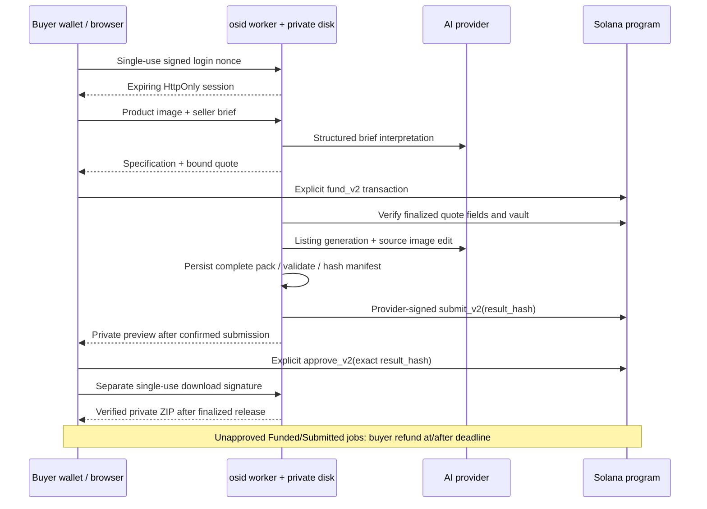

# osid architecture

The browser gets a versioned quote from the Fastify service, while the Anchor program controls token custody. Only the buyer's separate explicit transaction releases or refunds payment. The provider signer can submit a result commitment and cannot settle the buyer's deposit.

## Accounts and authority

V1 accounts and instruction discriminators are preserved. V2 uses distinct `JobV2` data and `job_v2` PDA seeds. Both use vault PDAs derived from the job; permanent terminal records prevent job ID reuse. Config remains the same immutable six-decimal legacy SPL mint configuration. No private inputs, prompts or copy go onchain.

| Action | Authorized signer | Required state/time | Effect |
| --- | --- | --- | --- |
| Fund V2 | Buyer | Valid quote, future bounded deadline | Atomically record immutable terms and exact deposit |
| Submit V2 | Recorded provider | Funded, before execution deadline | Freeze one nonzero result manifest hash |
| Approve V2 | Original buyer | Submitted, exact hash, strictly before deadline | Exact recorded amount to recorded merchant ATA; Released |
| Refund V2 | Original buyer | Funded or Submitted, at/after deadline | Exact recorded amount to buyer ATA; Refunded |

There is no provider payout, result replacement, withdrawal, arbitration or automatic refund instruction. Accidental surplus stays in the vault; rent remains allocated. The upgrade authority can change code and is an explicit prototype trust boundary. The application worker rejects use of that key as its provider signer.

## Commitments and delivery

`docs/INTERFACES.md` defines canonical JSON and exact binary terms encoding. The onchain program recomputes terms from job identity, participants, token fields, two deadlines and input/specification hashes. Provider submission freezes the canonical artifact-manifest hash. Approval includes that exact hash. These commitments bind the agreement and bytes; the buyer decides whether the content is acceptable.

The manifest lists six payloads; `manifest.json` is the seventh ZIP entry and excludes its own hash to avoid a cycle. A separately persisted bundle hash verifies ZIP bytes. File count, image dimensions, copy lengths, required fields and every payload hash are checked. Deterministic validation does not certify aesthetics, fact accuracy or third-party rights.

Login, download signing and token transactions use separate authorization flows. Nonces/sessions/challenge consumption persist through restart. Credentialed CORS uses exact allowed origins; authenticated mutations also require Origin and CSRF. An application session alone never releases funds or downloads originals.

`/recover` mounts its own direct-RPC client from compiled trusted settings. It does not load application auth or merchant APIs, supports both versions, derives canonical destinations from recorded chain fields and requires the original buyer's transaction. An API outage does not alter chain eligibility. Frontend and RPC access still need to be available.

## Deferred provider bond

A future version could require a provider performance bond before accepting work and make a defined portion slashable for missed measurable deadlines. It needs separate sizing, capital/withdrawal rules, griefing analysis and an objective failure policy; subjective image quality would still require a dispute model or buyer judgment. No bond or arbitration is implemented or claimed here. It is not a prerequisite for this product's buyer-controlled escrow/refund lifecycle.
